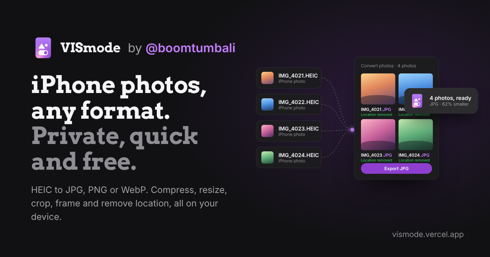

# VISmode

**iPhone photos, any format. Private, quick and free.**

VISmode turns iPhone HEIC photos into JPG, PNG or WebP, puts photos into one PDF, and gives you the photo tools people use every day: compress, resize, crop, frame, retouch, watermark and remove location. It's built for sharing photos from an iPhone to anything: Windows, Android, school portals and websites.

🔗 **Live:** [vismode.vercel.app](https://vismode.vercel.app): nothing to install, no sign-up. Works on phones, tablets and computers in Safari, Chrome, Edge and Firefox.
👤 **By:** [@boomtumbali](https://www.linkedin.com/in/boomtumbali) · one of the *mode* apps, with [PDFmode](https://pdfmode.vercel.app) for PDFs

---

## What it does

- **Opens iPhone photos anywhere:** HEIC and HEIF (including Live Photo stills), plus JPG, PNG, WebP, GIF, BMP, AVIF and SVG. TIFF opens in Safari.
- **Saves as JPG, PNG or WebP,** or puts photos into one PDF. Many photos come as one ZIP, each named like its original (`IMG_4021.jpg`).
- **Works in batches.** Add a whole iPhone export at once; one setting applies to every photo.
- **Live previews** for Crop & rotate, Add a border, Adjust & looks and Watermark, with a strip to check each photo.
- **Shows photo details before you share:** which photos reveal where they were taken, plus camera and date.
- **Keeps the date taken** when you want it (so galleries sort correctly); location is always removed.

## Tools

Nine free tools, with no limits and nothing uploaded:

| Tool | What it does |
| --- | --- |
| Convert photos | HEIC to JPG, or any photo to JPG, PNG or WebP. Can keep the date taken and camera; location is always removed |
| Photos to PDF | One PDF, one photo per page, in your order. Pages fit each photo, or A4 / Letter |
| Compress photos | Light, Balanced or Strong, with an optional "each photo under 2 MB / 1 MB / 500 KB" limit |
| Resize photos | Longest side 1080, 1600, 2048 or 4K, or 25/50/75%. Never enlarges |
| Crop & rotate | Original, 1:1, 4:5, 16:9, 3:2, 9:16 Story; drag to choose what stays; rotate and flip |
| Add a border | Fit the whole photo in a square, 4:5, Story or 16:9 frame with a white, black or blurred border. No cropping |
| Adjust & looks | Exposure, contrast, saturation, warmth, fade, vignette, and eight looks |
| Watermark | Your text in a corner, centred or repeated, in white, black or violet |
| Remove location | Removes location only (keeps date and camera) or everything. JPG and PNG keep every pixel |

After every export, VISmode confirms the file and suggests a useful next step. Picking one passes the photos you just made straight into that tool, so there's no re-uploading.

## File names

Exports are named after the first (or only) photo, then what was done to it: `IMG_4021-converted-by-vismode.vercel.app.zip`, `IMG_4021-photos-to-pdf-by-vismode.vercel.app.pdf`. Photos inside a ZIP keep their own names.

## Privacy

Everything runs in your browser. Your photos are **never uploaded** to a server. The app only downloads its own code libraries (from the jsDelivr CDN) when a tool needs them.

## How to use

1. Go to [vismode.vercel.app](https://vismode.vercel.app).
2. Click **Choose photos**, drop photos anywhere on the page, or pick a tool first.
3. Adjust the settings if you like: format, size, shape, look or text.
4. Click **Export**. The success screen confirms the file and offers a next step, like making the photos smaller or removing their location.

## Good to know

- **HEIC** opens with the browser's own decoder in Safari, and with an open-source decoder (libheif, about 3 MB) elsewhere. It downloads the first time you open a HEIC photo, then stays cached.
- **WebP:** some browsers (older Safari) can't save WebP; VISmode says so and saves JPG instead.
- **Large batches** are processed one photo at a time: slower, but they don't run out of memory.
- **Offline:** photos already added keep working. Opening new HEIC photos needs a connection the first time.
- **Video** (Live Photo motion, MOV, MP4) is planned for a later version.
- **The start-page film** is made in code: no video to download, it follows light and dark mode, scales to any screen, pauses when scrolled away, and stays still for people who turn off motion. If you later upload `vismode-promo-1080p.mp4` next to `index.html`, the page plays it instead.

## Run or host it yourself

VISmode is a single self-contained `index.html` with no build step.

**Run locally:** open `index.html` in a browser.

**Host on Vercel:**
1. Put `index.html`, `og-image.png` and this `README.md` in a GitHub repository.
2. On [vercel.com](https://vercel.com), choose **Add New → Project**, import the repository, leave the **Framework Preset** as **Other**, and click **Deploy**.
3. Every commit to the repository redeploys the site automatically, usually within a minute.
4. After changing `og-image.png`, Messenger and Facebook may keep the old picture until you press **Scrape Again** at [developers.facebook.com/tools/debug](https://developers.facebook.com/tools/debug).

> If your site address isn't `vismode.vercel.app`, update the `og:url`, `og:image` and `twitter:image` tags in `index.html` so link previews work.

### Repository contents

| File | Purpose |
| --- | --- |
| `index.html` | The whole app: interface, photo tools, icons and the GCash QR code (shown only when someone chooses to support) |
| `og-image.png` | Link-preview image for Messenger, Facebook, X and others |
| `README.md` | This file |

## Support

VISmode is free for everyone, with no ads, no limits and no sign-up. If it saved you time, you can chip in any amount through GCash (or any InstaPay bank app) from the support card: tap **@boomtumbali** in the header, or the small **Support** link after you export (also in the FAQ). It shows a short note first, and the GCash QR code only if you choose to chip in.

Follow the maker: [LinkedIn](https://www.linkedin.com/in/boomtumbali/) · [X](https://x.com/boomtumbali) · [GitHub](https://github.com/boomtumbali)

## Built with

| Purpose | Library |
| --- | --- |
| Opening HEIC photos | [heic-to](https://github.com/hoppergee/heic-to) (libheif, LGPL-3.0) |
| Reading photo details | [exifr](https://github.com/MikeKovarik/exifr) |
| Keeping date and camera | [piexifjs](https://github.com/hMatoba/piexifjs) |
| Photos to PDF | [pdf-lib](https://github.com/Hopding/pdf-lib) |
| ZIP downloads | [JSZip](https://github.com/Stuk/jszip) |

**Fonts:** Arvo (headings) and Inter (interface), from Google Fonts. All are free, open-licensed fonts.

---

Made by [@boomtumbali](https://www.linkedin.com/in/boomtumbali).
